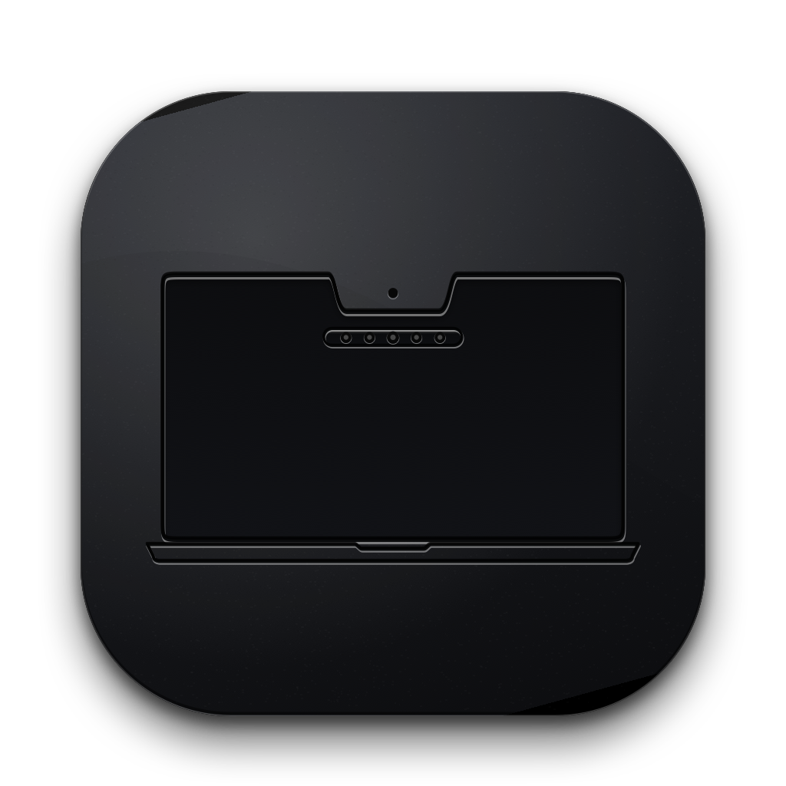

# 🐾 SimNotch (Simka Edition)

  

  <b>Второй уровень строки меню для MacBook с чёлкой и встроенный менеджер скрытия иконок</b> 
  <i>Легковесная, сверхбыстрая нативная утилита для macOS без сторонних библиотек и фреймворков.</i>

  
  
  
  

---

  

---

## 💡 Зачем нужен SimNotch?

На всех MacBook с аппаратным вырезом (MacBook Pro 14"/16", MacBook Air с вырезом M2/M3) экранное пространство в строке меню сильно ограничено. Когда активных утилит становится много, macOS просто вытесняет значки влево за пределы видимости (`X < 0`), и доступ к ним теряется.

**SimNotch решает эту проблему сразу с двух сторон:**
1. 🪟 **Второй уровень под чёлкой (SimNotch HUD):** автоматически находит вытесненные и скрытые иконки и элегантно отображает их на стильной полупрозрачной панели прямо под вырезом экрана.
2. 🎛️ **Встроенный Hidden Bar:** нативный перемещаемый разделитель (`|`) и стрелочка сворачивания (`<` / `>`) для компактной организации основной строки меню.
3. ⚡️ **Zero-Flicker движок (SkyLight WindowServer):** упреждающая синхронизация прозрачности окон (`SLSSetWindowAlpha`), устраняющая рывки и скачки всплывающих окон (Stats, календарь, мониторы системы).
4. 🐱 **Интерактивная пасхалка (Кошка Симка 🐾):** персонаж на панели с мурчанием (`purr.wav`) и секретным звуком при зажатом ...

---

## ⌨️ Горячие клавиши

| Сочетание | Действие |
| :--- | :--- |
| **`⌥ + \`** (Option + Backslash) | Мгновенно открыть / скрыть панель второго уровня под чёлкой |
| **`⌘ + ⌥ + H`** (Cmd + Option + H) | Свернуть / развернуть скрываемые утилиты в основной строке меню |
| **`⌘ + ,`** (Cmd + Comma) | Открыть окно настроек SimNotch |
| **Клик по значку в меню-баре `[⌄ X]`** | Открыть панель со всеми скрытыми значками |
| **`⌘` + перетаскивание разделителя** | Настроить границу скрытия для иконок меню-бара |

---

## 📦 Установка

1. Скачайте свежий образ **[SimNotch.dmg](https://github.com/and-ray-m/SimNotch/releases/latest/download/SimNotch.dmg)**.
2. Откройте `.dmg` и перетащите иконку **SimNotch** в папку **«Программы» (Applications)**.
3. **Первый запуск (Gatekeeper):**
   * При первом запуске нажмите по приложению **правой кнопкой мыши** (или с зажатой клавишей `Control`) в папке «Программы» → выберите **«Открыть»** → подтвердите запуск кнопкой **«Открыть»**.
4. **Разрешение «Универсальный доступ» (Accessibility):**
   * Для управления элементами меню-бара приложению требуется стандартное системное разрешение macOS:  
     *Системные настройки → Конфиденциальность и безопасность → Универсальный доступ → включить тумблер **SimNotch**.*

---

## 🛠 Системные требования

* **macOS:** macOS 12.0 Monterey, macOS 13 Ventura, macOS 14 Sonoma, macOS 15 Sequoia, macOS 27 и новее.
* **Процессор:** Apple Silicon (M1/M2/M3/M4) или Intel Core (64-bit).
* **Размер:** всего ~3.3 МБ (0 внешних библиотек, чистый Cocoa / Objective-C).

---

  Сделано с любовью к деталям и котикам 🐾

