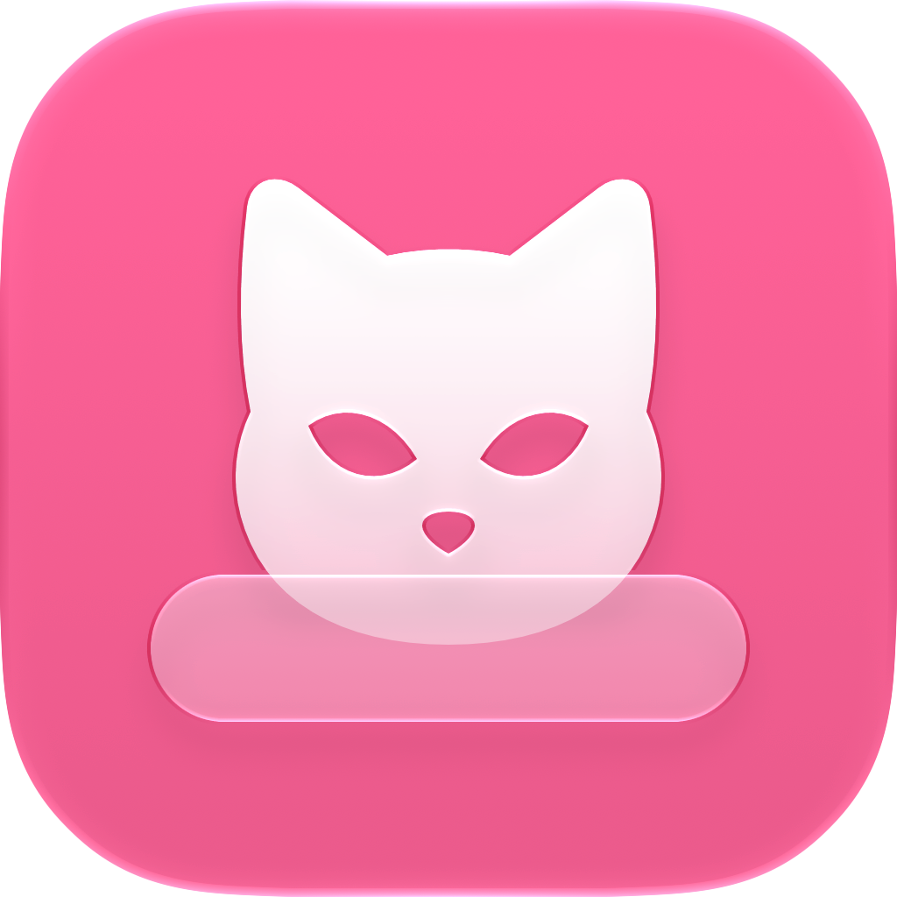
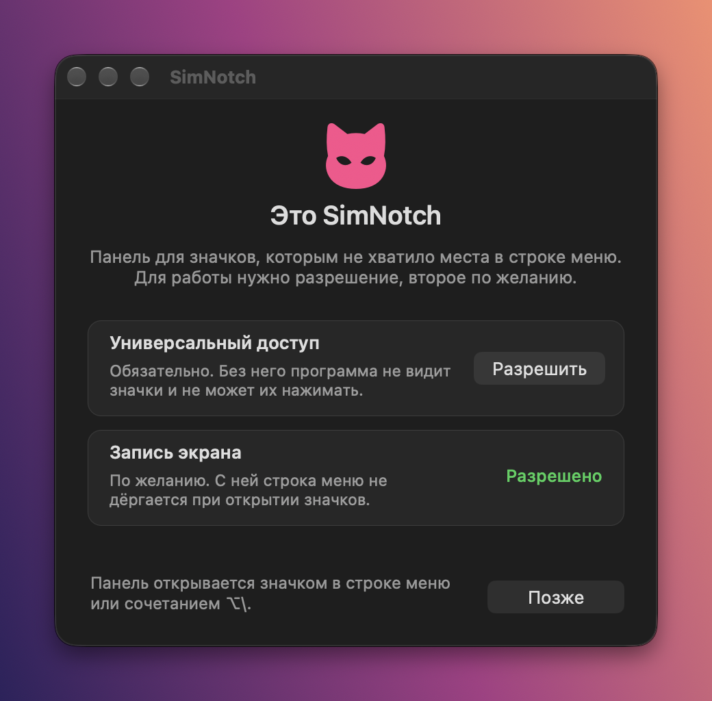
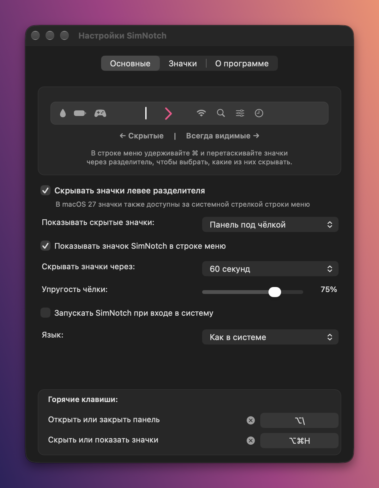

  

<h1 align="center">SimNotch</h1>

  <b>Чёлка MacBook, которая наконец-то работает на вас.</b> 
  Все значки, которым не хватило места в строке меню, в одном движении.

  
  
  

  

  

## Зачем это нужно

На MacBook с чёлкой места в строке меню мало. Когда значков становится много, macOS просто прячет лишние, и до них не добраться.

SimNotch возвращает их. Чёлка мягко расширяется и показывает всё, что не поместилось. Нажали на значок, и открылось его настоящее меню, как будто он всегда был на месте.

## Что умеет

**Панель из чёлки.** Панель вырастает из самой чёлки с мягкой пружиной. Упругость настраивается: от спокойной до весёлой.

**Настоящие меню.** Никаких копий. Нажатие открывает родное меню программы.

**Порядок в строке меню.** Перетащите разделитель с клавишей `⌘`, и значки слева от него будут прятаться одним нажатием стрелки.

**Дружит с Alcove и похожими программами.** Панель вырастает из той формы чёлки, что сейчас на экране, и уступает, когда другая программа разворачивается.

**Работает и без чёлки.** На внешних мониторах это капсула Liquid Glass, которая следует теме системы.

   
  

**Клавиатура и доступность.** Горячие клавиши меняются в настройках. Значки можно выбирать стрелками, их читает VoiceOver, а программа учитывает «Уменьшить движение» и «Уменьшить прозрачность».

**Кошка Симка.** Живёт на панели и мурчит, если её погладить. А ещё у неё есть секретный звук при зажатом ...

## Просто и понятно

При первом запуске SimNotch объяснит, какие разрешения нужны и зачем. Настройки выглядят как обычное окно Mac и следуют теме системы.

<table>
  <tr>
    <td></td>
    <td></td>
  </tr>
</table>

## Управление

| Что сделать | Как |
| :--- | :--- |
| Открыть или закрыть панель | `⌥ \` или значок Симки в строке меню |
| Скрыть или показать значки | `⌘ ⌥ H` или стрелка в строке меню |
| Выбрать значок в панели | стрелки, затем `Return` |
| Переместить разделитель | удерживайте `⌘` и перетащите `\|` |

## Установка

1. Скачайте **[SimNotch.dmg](https://github.com/and-ray-m/SimNotch/releases/latest/download/SimNotch.dmg)**.
2. Откройте образ и перетащите SimNotch в папку «Программы». Запускайте программу именно оттуда, иначе macOS может спрятать её собственные значки.
3. Откройте SimNotch. Программа пока не заверена Apple, поэтому macOS её остановит. Нажмите «Готово», откройте **Системные настройки → Конфиденциальность и безопасность** и нажмите **«Всё равно открыть»**.
4. Дайте разрешения в окне приветствия:
   * **Универсальный доступ** обязателен: без него программа не видит значки.
   * **Запись экрана** по желанию: с ней строка меню не дёргается при открытии значков. Снимки никуда не сохраняются и не отправляются.

**Обновляетесь с версии 3?** Если значки не появились, откройте вкладку «О программе» и выдайте разрешение заново.

## Требования

macOS 27.2 или новее и Mac на Apple Silicon. Около 3 МБ, без сторонних библиотек.

Работу на новых MacBook с Dynamic Island мы ещё не проверяли.

  Сделано с любовью к деталям и котикам

